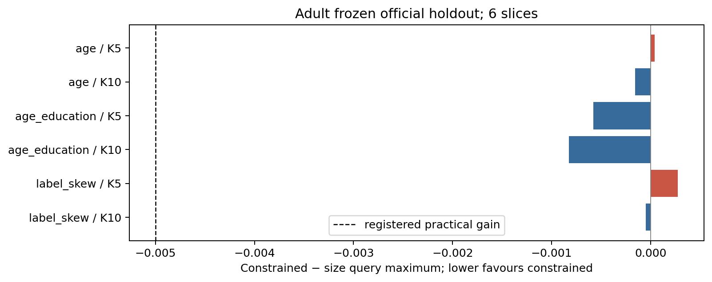

# Weighted Federated Synthetic Data Generation

**Start here:** [Results and statistical interpretation](docs/RESULTS_AND_STATISTICAL_INFERENCE.md) · [Twelve experiments](experiments/README.md) · [Theory and proof scope](theory/statements.md) · [Reproduce](REPRODUCIBILITY.md) · [Full artifact download](ARTIFACTS.md)

The repository has two reading levels: the guides above provide the research story, while the dated source directories preserve the records behind it. [Repository guide](docs/REPOSITORY_GUIDE.md) explains which files to read and which are historical evidence.



The plot shows seed-averaged slice differences, with negative values favouring constrained weighting. The dashed line is the registered practical-gain threshold; no independent-cohort confidence interval is implied.


A reproducible study of representation-constrained aggregation of heterogeneous **non-neural** tabular generators. Each client fits a joint model over the same schema; the statistical server combines released models and permitted summaries to synthesize records. The measured question is whether weighting improves a fixed empirical target over properly tuned size weighting.

## Main answer

The globally selected Adult procedure is a train/local-tune-selected projected Gaussian copula with `w=alpha`, where `alpha_i=n_i/sum n_j` is the declared client-mass target. The constrained challenger has `||w-alpha||_1<=0.25` and `w_i>=0.5 alpha_i`. Its paired primary query-max difference (challenger minus size; negative favours the challenger) was **+0.002427903** over 18 corrected Adult development slices (0/18 reached the registered -0.005 practical margin), **-0.000214907** over the frozen Adult official holdout (0/6 slices reached the margin), and **-0.001331749** in the registered Bank replication (0/4 slices reached it). These are bounded null/adverse findings, not equivalence or a universal impossibility result. See [all slices](AUTHOR_READY/PAPER_TABLES/), [closure](EXPERIMENTS_01_TO_12_CLOSURE.json) and [sign-off](AUTHOR_READY/FINAL_SIGNOFF.md).

The primary empirical reference is `b_R,l=sum_i alpha_i mean_{z in D_R,i} q_l(z)`; the synthetic answer is `b_S,l=mean_{z in D_S} q_l(z)`. Loss is `max_l |b_S,l-b_R,l|` over 152 registered Adult queries (143 one-way, eight extra two-way, one structural). An additional 23 queries were viewed during development. The official Adult test reused the same people across 12 configurations. `fnlwgt` remains a predictor, not a survey weight.

The frozen conditional teacher satisfied the requested filters, yet the female condition generated `relationship=Husband` at 0.340–0.399 where the alpha-standardized real female conditional reference had zero in the saved cells (mean discrepancy 0.375). The main release is **nonprivate**. Synthetic-trained versus privileged real-trained utility used unequal registered training budgets, which are stated in the tables.

## Project map

- [`btp/`](btp/): original data, models, weighting, projection, sampling, evaluation and privacy code.
- [`scripts/`](scripts/): original cell runners and report/audit tools; repository-specific lightweight wrappers.
- [`configs/`](configs/), [`environment/`](environment/): frozen campaign/resources and pinned Python dependencies.
- [`data/`](data/): official source variants, cleaning/split manifests and checksum provenance.
- [`results/`](results/), [`reports/`](reports/), [`AUTHOR_READY/`](AUTHOR_READY/): inspectable saved evidence, generated tables, captions and writing material.
- [`theory/`](theory/): original LaTeX and interpretation index; proofs and empirical checks remain distinct.
- [`artifacts/`](artifacts/), [`provenance/`](provenance/): full-archive manifest, source mapping and exclusion status.
- [`experiments/`](experiments/): twelve evidence-linked work-package guides.

## Experiment index

1. [Experiment 1: fixed target weighting](experiments/exp01_fixed_target_weighting/README.md)
2. [Experiment 2: pilot optimality](experiments/exp02_pilot_optimality/README.md)
3. [Experiment 3: subset composition](experiments/exp03_subset_composition/README.md)
4. [Experiment 4: synthetic sample size](experiments/exp04_synthetic_sample_size/README.md)
5. [Experiment 5: conditional generation](experiments/exp05_conditional_generation/README.md)
6. [Experiment 6: downstream utility](experiments/exp06_downstream_utility/README.md)
7. [Experiment 7: joint implied prediction](experiments/exp07_joint_implied_prediction/README.md)
8. [Experiment 8: query diagnostics](experiments/exp08_query_diagnostics/README.md)
9. [Experiment 9: controlled ablations](experiments/exp09_controlled_ablations/README.md)
10. [Experiment 10: heterogeneity](experiments/exp10_heterogeneity/README.md)
11. [Experiment 11: conditional transfer](experiments/exp11_conditional_transfer/README.md)
12. [Experiment 12: privacy and resources](experiments/exp12_privacy_and_resources/README.md)

## Quick start on Linux/Python 3.12

```bash
python3 -m venv .venv
.venv/bin/python -m pip install -r environment/requirements_final_portable_20261025.txt
.venv/bin/python -m pip install -e .
.venv/bin/python scripts/verify_data_sources.py
.venv/bin/python scripts/audit_repository.py
.venv/bin/python scripts/reproduce_repository.py --tables
.venv/bin/python scripts/reproduce_repository.py --figures
```

`python -m pytest -q` runs the original scientific test suite. The wrapper only reads saved result files. Full fitting is explicit and governed by [REPRODUCE](REPRODUCE.md) and the shared EC2 resource controller; do not run a campaign just to regenerate figures. The original final-package bootstrap expects the full v2 archive and is not the small Git checkout bootstrap.

## Evidence, data and limits

[Source and artifact status](ARTIFACTS.md) distinguishes files in Git from the verified 537 MB full archive. Model pickles require trusted provenance and are excluded from normal Git history. [Dataset provenance](data/README_GITHUB.md) records official UCI Adult and Bank sources/CC BY 4.0 attribution. [Theory](theory/README.md), [paper material](paper/README.md), [experimental history](docs/experimental_history.md), [release/privacy ledger](docs/FINAL_RELEASE_AND_PRIVACY_LEDGER.md), [reproducibility levels](REPRODUCIBILITY.md) and [rights](RIGHTS_AND_LICENSING.md) state what the project proves and does not establish. No whole-pipeline DP, arbitrary-condition fidelity, population-TV measurement, independently recruited cohort, or novel weighting-algorithm superiority is claimed. The 12 packages close at their registered bounded scope.

Please cite the research software using [CITATION.cff](CITATION.cff) and cite the original UCI datasets as recorded in their manifests.

**Full checkpoints and saved draws:** [private release archive](https://github.com/S-G-mathematics/btp-federated-synthetic-data/releases/download/repro-2026-10-31/BTP_FINAL_EXPERIMENTAL_PACKAGE_20261025_v2.zip); authenticate with repository access, then verify SHA-256 `b184b0b07d3185ca7bd95322fd7bf432b28293b1041f5cae5cc9153ead25b2bf`.
